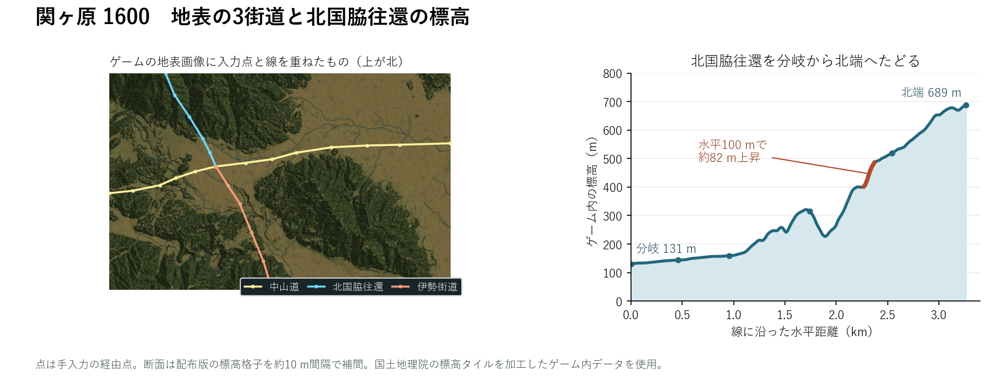

# 関ヶ原 1600 の史実検証

2026年11月28日。Claude 版『関ヶ原 1600』のコミット `8cd914de50` を対象とした。**合戦の日、主要人物の去就、東軍勝利とその後は史料に沿う。初期配置は主に現在の史跡案内に近い通説、合戦の時計と損害はゲームの仮定に大きく依存する。** とくに注意したいのは、小早川が東軍側で戦ったことと、家康が正午に鉄砲を撃たせたため決断したことの間にある、根拠の差である。

## 合戦のどこまで確かめられるか

| 論点 | ゲームの描写 | 照合結果 |
|---|---|---|
| 日付と勝敗 | 慶長5年9月15日（西暦1600年10月21日）、東軍勝利 | **整合する。** 石川昭光父子宛の伊達政宗自筆書状が、家康方の勝利の速報を伝える。ここから決着の分刻みの時刻までは決まらない。[仙台市博物館](https://jmapps.ne.jp/scm/det.html?data_id=2284)・[大垣市の暦日対照](https://www.city.ogaki.lg.jp/cmsfiles/contents/0000067/67849/simazu.pdf) |
| 秀忠と大津城 | 秀忠軍は上田を経由して間に合わず、大津城は決戦当日に開城 | **大筋が合う。** 上田で時間を費やしたこと、本戦に秀忠がいないこと、大津籠城が西軍の大軍を引きつけたことは各地の博物館解説と一致する。秀忠の遅参について上田市は道中の難航も挙げる。3万8千という動員数や各要因の寄与は別の論点。[上田市の第二次上田攻め解説](https://museum.umic.jp/sanada/sakuhin/uedazeme2.html)・[大津市歴史博物館](https://www.rekihaku.otsu.shiga.jp/event/jyousetsu/rekishi_4.html) |
| 開戦 | 8時に井伊直政・松平忠吉が抜け駆け、8時6分に福島正則が続く | **先手の顔ぶれには根拠がある。順番と時刻は一つの復元。** 合戦2日後の松平家乗宛連署書状写には巳の刻とあり、井伊と福島をともに先手に挙げる。どちらが最初の一発を撃ったか、両者の間が6分だったかは読み取れない。[九州文化財研究所シンポジウム資料・基調講演2、史料6](https://kyubunken.jp/kyubunken30thsymposium_resume.pdf) |
| 小早川と脇坂ら | 12時に問鉄砲、12時6分に小早川、12時31分に脇坂・朽木・小川・赤座が一斉に転陣 | **加勢の事実と、発砲による催促・時刻・内訳では確度が異なる。** 同書状写が名を挙げるのは小早川、脇坂、小川父子。同じ「四人」でもゲームの「小早川に続く四隊」とは構成が違う。一通に朽木・赤座が見えないことだけで両者の参加を否定することもできない。[九州文化財研究所・史料6](https://kyubunken.jp/kyubunken30thsymposium_resume.pdf) |
| 南宮山の毛利 | 吉川広家が動かず、毛利秀元らが本戦に加わらない | **不参戦と事前交渉は根拠が強い。** 吉川史料館は、前日に広家・福原広俊が徳川方と和議を結び、人質を送った経緯を説明する。一方、道を物理的に塞いだ状況や「空弁当」の台詞はその書状からは復元できない。「空弁当」を逸話とするカード表示は妥当。[吉川史料館『史料館だより』77号](https://www.kikkawa7.or.jp/hokanko/77_1.pdf) |
| 大谷・島津・三成の帰趨 | 大谷吉継が自害。島津義弘は退却して帰国。三成は敗走して古橋で捕らえられ、京で処刑される | **各人の帰趨は合う。** 大谷の自害を13時12分とする根拠、島津の退路の各通過時刻、三成が笹尾山のどこから何人で逃れたかは、これらの資料では確定できない。古橋での捕縛を詳述する長浜の展示品は1854年の聞き取りを記した覚書で、合戦当日の記録とは成立事情が異なる。[福井県文書館](https://www.library-archives.pref.fukui.lg.jp/fukui/08/2015exhb/201507mini/201507mini.html)・[大垣市](https://www.city.ogaki.lg.jp/cmsfiles/contents/0000067/67849/simazu.pdf)・[長浜城歴史博物館](https://nagahama-rekihaku.jp/digital-museum/49) |

### 問鉄砲と寝返りは別々に検証できる

国立公文書館が紹介する幕府編纂の『朝野旧聞裒藁』では、本文は秀秋の軍監らによる催促を採り、1713年序の『関ヶ原軍記大成』を引いた細字の部分に鉄砲の話が出てくる。白峰旬は江戸期の諸記録を比較し、問鉄砲を後世の創作と論じた。一方、問鉄砲の確度が低いことだけで、直ちに「開戦と同時に転陣し短時間で決着した」とも決められない。早期転陣説にも水野伍貴らによる再検討がある。既定版の問鉄砲カードが異説を紹介する点はよいが、現行の「もしも」欄には、史料の読み方が違う「早期転陣」と、実際に起きたことを変更する「西軍に残る」が並んでいる。[国立公文書館の原資料比較](https://www.archives.go.jp/exhibition/digital/rekishitomonogatari/contents/43.html)・[白峰旬の論文](https://beppu-u.repo.nii.ac.jp/records/2000750)・[水野伍貴『関ヶ原合戦を復元する』](https://www.kodansha.co.jp/book/products/0000381310)

## 地形と布陣の精度

戦場の中心をどこに置くかにも異説がある。9月15日付の伊達政宗宛家康書状は午の刻に美濃の「山中」で戦ったと伝え、9月24日付の小早川秀秋宛家康書状では「関ヶ原」と呼んでいる。白峰旬は両地での二段階の戦闘、小池絵千花は戦場の地名認識の変化からこの違いを説明する。ゲームの早期転陣版は同じ布陣で小早川の行動時刻を変えるため、主戦場をめぐるこうした研究上の復元までは試せない。[本多隆成による両書状と論争の解説](https://fujinkoron.jp/articles/-/10039?page=2)

地形は国土地理院の現代の標高タイルから作成され、街道・村落・地表は別に推定している。部隊の移動・交戦は平面座標で計算し、標高差や峠道の通りやすさを直接使わない。陣地の強さは部隊別の係数に与えている。そのため、画面に見える山が、特定の隊を実際に足止めしたと解釈することはできない。[地形取得コード](../../../../Claude/game/sekigahara/tools/fetch_dem.py)・[街道と村落](../../../../Claude/game/sekigahara/data/geo.json)・[移動・交戦の実装](../../../../Claude/game/sekigahara/js/sim.js)

既定版が採用する通説上の陣跡について、名称が対応する5地点を照合した。距離は緯度・経度から求めた水平直線距離で、部隊中心と現在の史跡の代表点の差を示す。史料から判明した1600年の本人の位置を測った値ではない。布陣図そのものにも、近世の軍記から近代の地図・現地標柱へと定着した経緯がある。[関ヶ原位置情報リスト2013年度](https://linkdata.org/work/rdf1s884i/SekigaharaLocationData.html)・[早稲田大学掲載の布陣認識の形成史研究](https://www.waseda.jp/flas/rilas/assets/uploads/2026/01/346-321_Echika_KOIKE.pdf)

| 陣地 | ゲームの緯度・経度 | 現地案内点の緯度・経度 | 距離 |
|---|---|---|---:|
| 徳川家康の最初陣・桃配山 | 35.3648, 136.4890 | 35.365395, 136.488411 | 約85 m |
| 小早川秀秋・松尾山 | 35.3478, 136.4552 | 35.347274, 136.454304 | 約100 m |
| 石田三成・笹尾山 | 35.3736, 136.4600 | 35.371796, 136.458746 | 約230 m |
| 黒田長政・丸山 | 35.3760, 136.4668 | 35.369519, 136.470561 | 約800 m |
| 徳川家康の移動先・陣場野 | 35.3668, 136.4760 | 35.365809, 136.465098 | 約1,000 m |

とくに陣場野は、ゲーム内の移動先が最後陣跡の約1 km東にある。家康が三成の正面へどれだけ近づいたか、島津が家康本陣のどこを通ったかを読み取る場面に影響する。ゲームは島津本隊が家康の650 m以内を通ると「家康本陣の目の前を」を表示する。座標の差が、この判定距離そのものを上回る。[徳川家康コースの現地解説](https://sekigahara.pref.gifu.lg.jp/tokugawa-ieyasu/)・[布陣データ](../../../../Claude/game/sekigahara/js/units.js)・[移陣と距離判定](../../../../Claude/game/sekigahara/js/scenario.js)

## 兵数と実行結果

開戦時の兵数は西軍20隊81,290人、東軍22隊88,878人。島津の退却時に本隊から兵を割り当てる非表示枠8個は除いた。大垣の布陣図と比べると、宇喜多17,000・家康30,000は一致するが、小西はゲーム4,000に対して図6,000、吉川は3,000に対して4,200。島津の計1,500は一致しても、義弘・豊久の配分は900・600と750・750に分かれる。同じ通説を説明する図にも幅があり、図自体にも兵数は諸説と明記されている。[大垣の布陣図](https://www.ogakikanko.jp/shimazunonokiguchi/tirasi.pdf)

既定版の実行順は、8時00分開戦、12時00分問鉄砲、12時06分小早川転陣、12時31分脇坂ら転陣、13時12分大谷隊崩壊、13時20分小西隊、13時41分宇喜多隊、14時29分石田隊崩壊・東軍勝利、14時34分島津突破開始、15時38分島津離脱だった。

- 小早川は戦況や実際の発砲を判定せず、設定した時刻が来ると所属を変える。四隊はそこから25分後に一斉に転じる。一方、大谷・小西・宇喜多・石田の崩壊時刻は人数・士気などの計算から出る。この4隊が崩れた時点で既定版の東軍勝利となる。
- 自動テストは **13/13合格**。たとえば「小早川の転陣は正午付近」「小西隊は宇喜多隊より先に潰走」「東軍勝利は13時～14時45分」が合格条件である。これは版を更新しても選んだ筋書きを保てるかの検査で、13件の史料照合を意味しない。[テストの判定条件](../../../../Claude/game/sekigahara/tools/sim_test.mjs)
- 最終ログの損害は西軍15,428、東軍5,975。転陣者も元の所属で集計し、決着後の追撃分を含む。島津の離脱232人は戦場を離れた時点のモデル値で、カードの「帰国できたのは80余人」とは地点も時点も違う。画面はその違いを注記している。逆に捨て奸のカード本文は「数人ずつ」だが、実行ログの最初の組は105人。実装は本隊残数の12%を切り離すためで、説明と目にする規模に食い違いがある。[シナリオ](../../../../Claude/game/sekigahara/js/scenario.js)・[画面表示](../../../../Claude/game/sekigahara/js/main.js)

### 条件を変えると何が分かるか

ほかの選択を既定のまま一項目だけ変更した。小早川を早期転陣にすると8時25分に東軍へ移り、東軍勝利は13時40分。小早川が最後まで中立でも15時27分に東軍が勝つ。西軍に加勢させると日没引き分け。吉川に道を開かせた場合は既定版と同じ14時29分に東軍勝利となった。毛利勢の動きは変わっても、東軍の勝利判定の中心は西軍主力4隊の状態である。各選択から読み取れるのは、この初期兵力と勝敗条件を採ったときの結果までである。

画面で選べる5項目の**全64通り**も、同じテスト関数で一度ずつ実行した。東軍勝利44、日没引き分け20、西軍勝利0。内訳は次のとおり。なお四隊の行動分岐は小早川の東軍転陣を条件にしており、選択の組み合わせが異なっても挙動が同じ場合がある。この件数から当時の勝率は推定できない。

| 小早川の選択 | 東軍勝利 | 日没引き分け | 西軍勝利 |
|---|---:|---:|---:|
| 正午過ぎに東軍へ | 12 | 4 | 0 |
| 開戦まもなく東軍へ | 16 | 0 | 0 |
| 最後まで中立 | 16 | 0 | 0 |
| 西軍として参戦 | 0 | 16 | 0 |

**学習上もっとも明確な矛盾は早期転陣版にある。** 8時25分に小早川が東軍に転じ、8時50分に脇坂らが続いた後も、10時40分には既定版と同じ狼煙カードが出る。そこでは三成が小早川と毛利に参戦を促し、双方とも動かなかったと説明する。その回の再生内容と解説文が矛盾している。[狼煙カードと発火条件](../../../../Claude/game/sekigahara/js/scenario.js)

検証には Node.js 22.14.0 を使用。`Claude/game/sekigahara` で `node tools/sim_test.mjs`、分岐は同コマンドに `--if kobaya=early`、`--if kobaya=neutral`、`--if kobaya=west`、`--if kikkawa=open` を個別に付けて再現できる。対象コミットの配布用 `index.html` に、テスト対象と同じ部隊・戦闘・シナリオのコードが埋め込まれていることも確認した。

## 地形に引かれた白線と街道の修正案

野を横断して関ケ原付近から北西と南東へ枝分かれする淡い線は、中山道・北国脇往還・伊勢街道。地表画像を生成する際、経緯度を順番に結び、暗い縁と明るい土色で上描きしている。川は別処理で青灰色、田の畦は小さな区画の境を暗い色で描く。画面の特定箇所を示す画像は提供されていないため、ここでは配布版の地表に常時描かれる長い3本を照合した。[経路の原データ](../../../../Claude/game/sekigahara/data/geo.json)・[地表の生成処理](../../../../Claude/game/sekigahara/tools/bake_texture.py)

| ゲームの経路 | 入力点の数 | 最も長い直線区間 | 道に沿った水平100 m間の最大標高差 |
|---|---:|---:|---:|
| 中山道（東西） | 13 | 約1.54 km | 約28 m |
| 北国脇往還（北西） | 6 | 約0.81 km | 約82 m |
| 伊勢街道（南東） | 6 | 約0.96 km | 約47 m |

配布版の `geo.js` と `geo.json` の点列の一致を確認し、`dem.js` の標高を描画コードの `heightAt` と同じ双線形補間で約10 mごとに読んだ。北国脇往還はゲーム内の分岐（標高約131 m）から3.26 kmで地図の北端（約689 m）へ達する。特に分岐から約2.27 kmの地点では、水平100 mで約402 mから約485 mへ上る。道の生成時にはこの縦断勾配を参照しない。さらに地表画像は約2.6 m/画素で、縁を含む5～6画素の帯は地表換算で約13～16 m幅に見える。画像上の太さであり、歴史的な道幅を表す値ではない。[描画側の標高処理](../../../../Claude/game/sekigahara/js/main.js)・[入力した線を焼き込む処理](../../../../Claude/game/sekigahara/tools/bake_texture.py)

1. **最初の改修は北国脇往還の引き直し。** 関ケ原町の景観計画にある旧街道図を標高図に合わせ、笹尾山麓から玉集落へ向かう筋を追う。分岐・集落の出入口・谷の曲がり・渡河点を先に特定し、必要な所へ経由点を打つ。伊勢街道は烏頭坂から牧田へ向かう道筋、中山道は山中・野上付近の東西路を照合する。実在する峠道の上りは残す。近世の宿場整備と合戦の年には年代差があるため、後世の地図が手がかりの区間は「推定」として扱う。[関ケ原町景観計画・第1章](https://www.town.sekigahara.gifu.jp/secure/6497/daiissyou.pdf)・[関ケ原町歴史民俗学習館](https://rekimin-sekigahara.jp/main/history/)・[大垣市の烏頭坂・牧田周辺図](https://www.city.ogaki.lg.jp/cmsfiles/contents/0000067/67849/simazu.pdf)
2. **遠景の読みやすさと地表の道幅を別々に調整する。** 地表は細い土色の帯にして一様な縁取りを弱める。俯瞰で街道を読みたいときは解説地図に路線名と強調線を出す。経路の裏が取れていない区間は、先に地表から外し、解説地図だけに推定の破線で残せる。経由点をそのまま滑らかにつなぐだけでは、現在の急斜面を通り続ける。
3. **変更後は地表・解説図・沿道の家並みを一緒に見る。** 正本の `data/geo.json` を更新し、`tools/bake_texture.py` で `ground.js` と `geo.js` を再生成する。解説図の道は共通データを読むが文字の位置は固定で、沿道の家は集落中心から一直線に並ぶ。急カーブを入れた所では家が実際の道沿いに並ぶかを確認する。島津の退路も独立した点列なので、伊勢街道と重なる描写をする区間だけ位置関係を見直す。仕上げに同じ断面図を取り直し、残る急坂が資料上の峠・坂と対応するかを確かめる。[解説地図](../../../../Claude/game/sekigahara/js/maps.js)・[集落配置](../../../../Claude/game/sekigahara/js/main.js)・[島津の退路](../../../../Claude/game/sekigahara/js/scenario.js)

## 島津の退き口直前に見える三成と義弘

既定シナリオ（`1429d8ad60`）を再生し、ゲームの出来事が起きた時点で各隊の中心座標と接触判定を読み取った。標高は配布版の地形、距離は部隊の中心間の水平距離による。

| ゲーム内時刻 | 石田隊の状態と標高 | 島津義弘隊の周辺 |
|---|---|---|
| 7:30 布陣 | 笹尾山の初期位置、約195 m | 小西隊が約181 m、豊久隊が約207 m |
| 14:19 石田隊潰走 | 約198 mで潰走開始 | 豊久隊が約207 m、東軍に転じた小早川隊が約218 m |
| 14:24 島津突破開始 | 約294 m、初期位置から約482 m、モデル上の残兵676人 | 豊久隊が約207 m、小早川隊が約224 m、福島隊が約485 m。義弘隊の接触相手は0隊 |

**三成。** 笹尾山を本陣とし、麓に前衛を置き、敗れて伊吹山方面へ逃れた、というのが現地の説明である。ゲームでは石田隊の潰走後に5分間の待ちがあり、その間も残兵を一つの集団として北西の固定座標へ直進させる。勾配や山道は移動計算に入らない。退き口の時点で山中に見えるのはこの移動の結果で、三成本人と約700人の行動をこの場所まで追跡できたものではない。[岐阜県の史跡解説](https://www.pref.gifu.lg.jp/page/366371.html)・[笹尾山の現地解説](https://www.kankou-gifu.jp/spot/detail_6731.html)

**島津。** 西軍の敗北後に義弘が敵中を突破した大筋には史料上の裏付けがある。出発直前、誰が何メートルまで近づいていたかは、ここで参照した史資料からは確定できない。ゲームでは義弘・豊久を待機させ、東軍が攻撃先を選び直すときも候補から外す。味方の支援が失われることに加え、周囲に敵がいても義弘の正面で交戦しにくい仕組みが、静かな見え方を生んでいる。[東京大学史料編纂所『島津家文書之五』](https://www.hi.u-tokyo.ac.jp/publication/syoho/51/pub_komonjo-iewake-16-05/)・[大垣市のガイドマップについて](https://www.city.ogaki.lg.jp/0000042898.html)・[シナリオ](../../../../Claude/game/sekigahara/js/scenario.js)・[移動・接触の処理](../../../../Claude/game/sekigahara/js/sim.js)

## 笹尾山の本陣と小早川隊の改修後

記念館の史跡案内では、三成が笹尾山に布陣し、島左近らがその麓で戦った。小早川勢の攻撃を受けた大谷の陣は、松尾山を正面に見る山中にある。この位置関係をもとに、既定シナリオを次のように改めた。[岐阜関ケ原古戦場記念館の史跡案内](https://sekigahara.pref.gifu.lg.jp/ishida-mitsunari/)

| 場面 | 改修後の再生結果 |
|---|---|
| 開戦から14時16分まで | 石田本隊の馬印と陣幕を笹尾山の陣跡にそろえた。左近・蒲生の前衛は別部隊として動く。小西・宇喜多が崩れると本陣の防御補正が解け、石田隊もやがて潰走する。 |
| 石田隊の潰走 | 本陣から北へ約220 m退いたところで隊の表示を終える。離脱点は演出上の区切りで、三成個人の逃走経路は描かない。 |
| 14時21分、島津の退き口開始 | 松尾山を下った小早川隊は、大谷勢との戦闘を終え、大谷陣跡から約147 mの位置で停止。義弘隊との中心間距離は、前掲の旧版の約224 mから約1,015 mになった。 |

時刻と距離はゲーム内の再生値である。島津の出発時に小早川が実際にどこで足を止めたかは、参照した史料からは特定できない。

## 追記　武将図鑑の兜と陣装束（2026年11月29日）

今回見直した十人のうち、合戦当日の姿と結び付く資料があるのは、とくに黒田長政と細川忠興である。他の人物には、本人ゆかりの別の戦役の甲冑や、桃山期の装いも参考にした。顔はいずれもゲームの想像図である。

| 人物 | 図鑑に採った特徴 | 史料で確かめられる範囲 |
|---|---|---|
| 黒田長政 | 銀色の板が後頭部から立ち上がり、額の上へ大きく曲がる一の谷形兜。横から見ると、折り返しの下に空間がある。 | 福岡市博物館は関ヶ原で着用した兜としている。崖を表す板の向きは同館公開の側面写真にもとづく。[収蔵品解説](https://jmapps.ne.jp/fukuokacity/det.html?data_id=298)・[側面写真を含む同館の解説](https://fcmuseum.blogspot.com/2020/11/blog-post_18.html) |
| 細川忠興 | 黒い頭形兜の頂に縞のある山鳥の尾羽を束ね、黒糸威の胴を合わせた。 | 永青文庫所蔵の忠興所用具足を参照。東京国立博物館は関ヶ原の合戦で用いたと伝わる品として掲載している。[東京国立博物館ニュース第700号、2頁](https://www.tnm.jp/uploads/r_db/publication_news/news2010-04_45_2.pdf#page=2) |
| 島左近 | 細い筋が密に並ぶ鉢と眉の上の低い金具。 | 久能山東照宮に伝わる五十二間筋兜。左近所用という伝承があり、現存品の写真から鉢と前飾りを描いた。[久能山東照宮の展示と写真](https://www.toshogu.or.jp/news/no.php) |
| 加藤嘉明 | 銀色の山裾が左右へ大きく張り出す富士山形。 | サントリー美術館の出品目録115番は遊就館蔵の兜を「伝加藤嘉明所用」とする。張り出し方は甲冑師・三浦公法による写しの掲載写真も参照した。[出品目録](https://www.suntory.com/sma/exhibition/visual/2008_03/pdflist.pdf)・[『刀剣界』第59号、5頁](https://www.toukenkumiai.com/wp/wp-content/uploads/no59.pdf#page=5) |
| 脇坂安治 | 藍の威糸の胴に、黒い冠と左右へ広がる薄い立物を合わせた。 | 龍野神社伝来の具足の現状を参照。たつの市は、秀吉から拝領したとの伝承を紹介しつつ、兜は別の取り合わせと明記する。この組み合わせの関ヶ原着用は未詳。[たつの市立龍野歴史文化資料館の解説と写真](https://www.city.tatsuno.lg.jp/soshiki/1041/gyomu/4/3/3798.html) |
| 浅野幸長 | 小ぶりの鉢から細い棒が一本立ち、その先端に丸い毛飾りが付く。 | 『陸軍特別大演習記念特別展観図録』第十九図「淺野幸長朝鮮陣着用甲冑」の解説と正面写真を参照。関ヶ原以前の装いを手がかりとした。父・長政の具足とは区別した。[国立国会図書館・解説（40コマ）](https://dl.ndl.go.jp/pid/1226596/1/40)・[同図版（41コマ）](https://dl.ndl.go.jp/pid/1226596/1/41) |
| 平塚為広 | 鎧の上に、兜を脱いで低く折った烏帽子が見える陣中姿を描いた。 | 今回調べた資料では本人所用の兜を特定できず、陣中の一場面を想像した。関ヶ原での行動は記念館の碑の解説を参照。[岐阜関ケ原古戦場記念館・平塚為広碑](https://sekigahara.pref.gifu.lg.jp/otani-yoshitsugu/) |
| 蒲生郷舎 | 平たい天板と大きな鋲が特徴の、鉄錆色の置手拭形兜。 | 同時代の作例から選んだ想像図。郷舎の所用品を特定する資料は今回確認できなかった。[文化遺産オンライン・桃山期の鉄錆地置手拭形兜](https://online.bunka.go.jp/heritages/detail/205118) |
| 島津義弘 | 金の大きな前立と丸に十の字で描いた従来の姿。 | 指定された加野厚志の書籍表紙に沿った意匠。今回確認した資料からは、表紙の兜を当日着用したことまでは裏付けられない。 |
| 島津豊久 | 白鉢巻と赤い陣羽織を着けた若い薩摩武将。 | 指定された人物像に沿った創作。鉢巻の色や陣羽織は当日の装束としては未確認。 |
