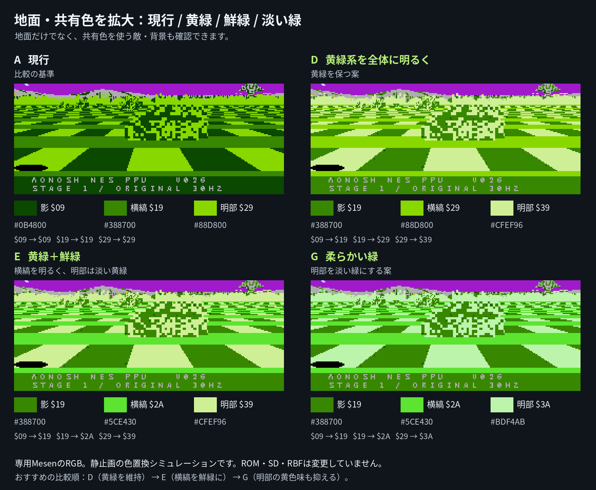

# 比較画像と色見本

本文の試行錯誤を追うための資料。初期モックは実機出力ではなく、後期に実機対応した配色と同一ではない。第三者の原作や提供画面を並べた比較は、単体素材と同様、公開版ではなく手元の参照資料に分けた。

## 色をどう振り分けるか

- [初期ラフ：紫の空と緑の地面](palette_rough_01.png)
- [地面2色 / 3色と、敵に残せる色](palette_ground_2_vs_3.png)
- [地面の緑4案を拡大](SpaceHarrier_NES_4_candidates.png)（12案の原本はローカル資料）
- [葉を `$1A` にする案と、中間色 `$2A→$2B` の比較](SpaceHarrier_tree_1A_mid_2A_2B_comparison.png)
- [空と地面にまたがる敵の目の比較](fixed_sky_ground_enemy_eye_comparison.png)

## 実機と専用Mesenの色見本

- [実機取り込みとMesenの色比較](NES_Color_Comparison.png)
- [複数ページを並べた色見本](NES_All_Pages_Comparison.png)
- [記録した実機画面](hardware_t18.png)・[Mesenの元カラーバー](mesen_page0.png)

[日別の開発ログ](../README.md#開発の時系列)に、採用しなかった案も含めて、個別の比較結果と判断を記録している。画像に出る色番号はファミコンのパレット値で、PCとテレビでの見え方が同一という意味ではない。
