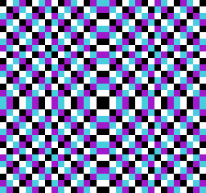
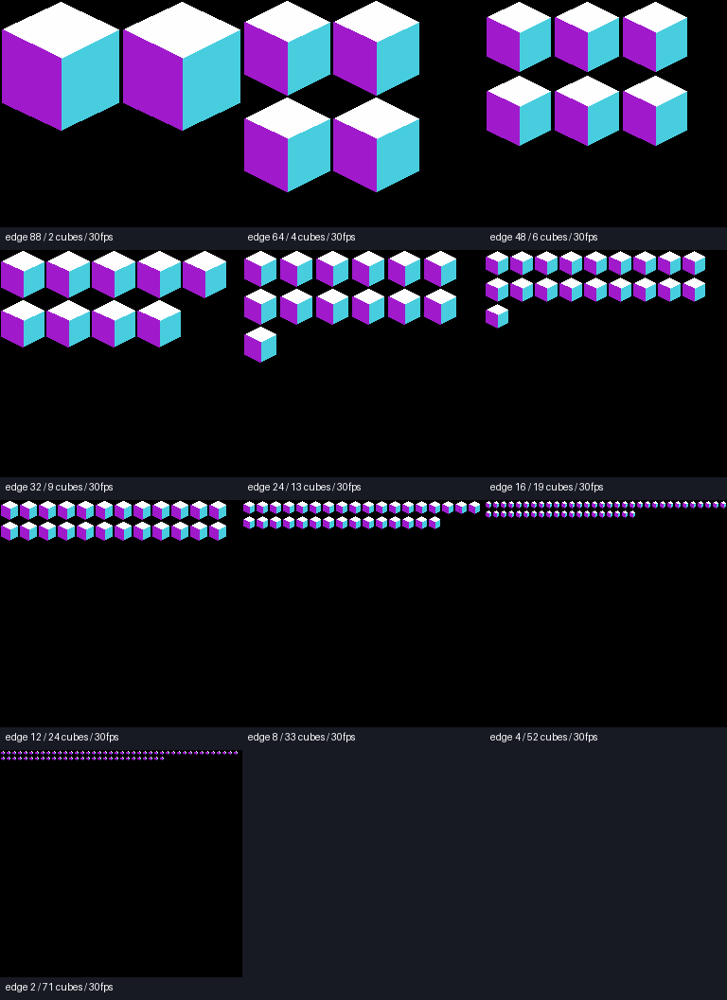
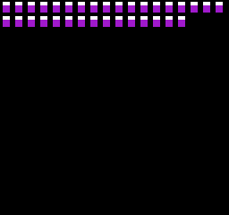

# GSUの直接ビットマップ表示・面塗り回転・30fpsベンチマーク v001

2026年10月14日。128×128 → 256×64 → 全画面256×240の順に、GSU描画RAMをPPUから直接表示した。続いて白・水色・紫の面を持つ立方体を30fpsで回転させ、縮小した立方体の個数上限を検証した。

**性能値はエミュレーターの時間モデルでの測定。新設した提案ABI2は現行N8 ProのABI1 RTLには存在せず、FPGAへの収まり・メモリー帯域・実機性能は未確認。**

## 起動

専用ランチャーは projects/nes_superfx にある。標準Mesenはこのマッパーを持たないため、ROMを標準版へ直接開かない。

- [run_bitmap_128.cmd](../../../run_bitmap_128.cmd)：中央128×128、位置識別パターン。
- [run_bitmap_band.cmd](../../../run_bitmap_band.cmd)：中央256×64、同じ表示経路。
- [run_bitmap_full.cmd](../../../run_bitmap_full.cmd)：256×240の全画面パターン。
- [run_solid_cube.cmd](../../../run_solid_cube.cmd)：立方体１個、面塗り、30fps回転。
- [run_cube_benchmark.cmd](../../../run_cube_benchmark.cmd)：サイズ・個数をメニューで選んで表示。辺長指定は --edge 8 など。


## 段階ごとの成果

| 段階 | 表示領域 | 確認 |
|---|---|---|
| 1 | 128×128、位置64,56 | GSUがPLOTした画素とPPUの全RGBが一致 |
| 2 | 256×64、位置0,88 | X=127/128を含むnative GSU配置を確認 |
| 3 | 256×240、位置0,0 | Y=63/64・127/128・191/192、全画面が一致 |
| 4 | 全画面上の立方体１個 | 64姿勢、完成画像を毎２フィールド提示、遅延0 |
| 5 | サイズごとの複数立方体 | 各64姿勢、成功個数と次の失敗個数の境界を検査 |



１画像16 KiB、前後２画像32 KiB、作業・コード8 KiBの計40 KiB RAM。GSUは背面へ描画し、STOP/RPIX後にVBlankで表示bankを切り替える。CPUからPPUへの画像転送は行わない。PPUのnametable fetchでタイル座標を保持し、pattern fetchをGSUのnative 2bpp配置へ変換する。64行帯をCPU割込みで切り替える方式ではなく、先読みも同じ座標経路で処理する。スクロール0、sprite無効、背景の共通４色パレットが対象。

## 立方体の描画

GSUが毎画像、８頂点の固定小数点行列変換、面の４辺のBresenham走査、走査線の左右端の抽出、PLOTによる面塗りを実行する。描画コード392byteは512byte cacheへ収まる。CPUは64姿勢の係数表と可視面の頂点番号を渡す。画像や塗り区間の事前計算・画像の使い回しは行わない。

X軸の面を水色、Y軸を白、Z軸を紫とし、裏面へ回っても軸ごとの色を維持する。正射影・一定ピッチ・Y軸回転の簡単なモデル。透視投影、Z-buffer、物体間の重なりは対象外。毎画像、背面16 KiBを全部消去してから描く基準実装で、消去の省略や差分描画の最適化はしていない。

NTSCの２フィールド周期、約30.05fpsを30fpsと表記する。１個のGSU最長時間は13.772ms。CPUの係数転送・GO待ち・VBlank採用も含めた実NES ROMの提示間隔を検査し、64姿勢すべてで毎２フィールド・遅延0を確認した。

## サイズ別の結果

辺長は投影前のモデル座標。画面上の幅は回転で変わる。すべて同サイズ・同位相の立方体を非重複の格子へ配置した。最大数は「今回の64姿勢すべてで毎２フィールド提示・遅延0」を満たした個数であり、別モデルや任意のカメラ・角度の性能保証ではない。辺長2/4は数画素へ量子化され、極小モデルの処理限界を見る条件。

| モデル辺長 | 30fpsの個数 | 最長GSU時間 | 境界の確認 |
|---|---:|---:|---|
| 88 | **2** | 22.952 ms | 非重複配置の上限2個 |
| 64 | **4** | 29.302 ms | 非重複配置の上限4個 |
| 48 | **6** | 31.018 ms | 7個で遅延（64回） |
| 32 | **9** | 30.041 ms | 10個で遅延（24回） |
| 24 | **13** | 31.985 ms | 14個で遅延（64回） |
| 16 | **19** | 32.456 ms | 20個で遅延（61回） |
| 12 | **24** | 32.268 ms | 25個で遅延（41回） |
| 8 | **33** | 31.948 ms | 34個で遅延（28回） |
| 4 | **52** | 32.006 ms | 53個で遅延（2回） |
| 2 | **71** | 32.136 ms | 72個で遅延（11回） |

辺長88/64の行は画面の配置上限に達しており、GSUの演算上限を測った行ではない。その他の行は１個増やすと、64姿勢のどこかで３フィールドの更新が生じた。GSUだけの時間が33ms未満でも、CPUの準備とVBlankの締切によって失敗する場合がある。失敗時も完成前のbankを表示せず、前の画像を保持する。





## 検証と再現

位置識別パターンはX/Y上位bitを色へ混ぜ、象限の取り違えを検出する。Pythonの参照描画とGSU RAMの全画素、最終PPU 256×240全RGBを一致比較する。回転は64姿勢。各画像の更新世代・表示bank・GSU時間・提示field・期限遅延数をLuaで取得し、fault=0も確認する。

ここに保存した段階試験・１個・10サイズの成功例・８サイズの次個数失敗例で、GSU計74,805,248画素、PPU計74,895,360 RGB画素を照合した。失敗例の「失敗」は性能期限の遅延であり、描画画素の不一致ではない。

- [benchmark.json](results/benchmark.json)：条件・成功/失敗の全trace・計測値。
- [verification.zip](results/verification.zip)：各ROM、設定、描画プログラム、Lua、PPU画像、GSU画像RAM、phase、trace。
- [sha256.json](results/sha256.json)：ROM・コア・ソース・証跡のhash。
- [ABI2_HANDOFF.md](ABI2_HANDOFF.md)：回路側へ渡すメモリー・レジスター・PPU接続契約。
- [design_log.md](design_log.md)：依頼原文、設計と修正の経緯。

必要なツールは専用コアのビルド環境に加え、PATH上のcc65（ca65/ld65）、Python、Pillow。GSU用casfx.incはtools/build_bitmap.pyが固定commitから取得しhashを確認する。projects/nes_superfx を作業ディレクトリにして実行する。

```powershell
python tools/build.py --fetch
cmake -S . -B build -G "Visual Studio 17 2022" -A x64
cmake --build build --config Release
ctest --test-dir build -C Release --output-on-failure
python tools/setup_runtime.py
python tools/build_bitmap.py --mode 1
python tools/run_bitmap.py build/bitmap/bitmap_1
python tools/build_bitmap.py --mode 2
python tools/run_bitmap.py build/bitmap/bitmap_2
python tools/build_bitmap.py --mode 3
python tools/run_bitmap.py build/bitmap/bitmap_3
python tools/build_bitmap.py --kind solid --half 44 --count 1
python tools/run_bitmap.py build/bitmap/solid_44_1
python tools/benchmark_bitmap.py
python tools/package_bitmap.py
python tools/verify.py
python tools/verify_frontend.py
python tools/verify_cube.py
```

25MHz基準、CLSR=0のMesen由来GSUの待ち時間・命令実行を使った機能モデル。ホストPCの壁時計時間からfpsを算出していない。PPU独立ポートと40 KiB RAMは提案した構成であり、現行RTLのメモリー待ち・非同期バス・同時アクセスを再現したモデルではない。旧ABI1の無変更診断ROMと線画デモも回帰検証済み。

## Aボタンで切り替える１本のROM

追加依頼に合わせ、GSU_CubeBenchmark_A_v001.nesを作成した。[run_cube_benchmark.cmd](../../../run_cube_benchmark.cmd)の引数なし起動はこちらを表示する。NESのA（このPCの専用設定ではZキー）を押すたびに、上表の２→４→６→９→13→19→24→33→52→71個→２個へ進む。辺長も表の条件へ切り替わる。長押しは１回だけ進み、離して再度押すと次へ進む。

画面下のN=は個数、S=は投影前のモデル辺長。文字は固定CHRの第２pattern tableを使うspriteで表示する。背景のGSUビットマップは第１tableを使い、文字の合成にCPUから画像を転送しない。構成変更時だけGSU停止中にモデル・描画リストを更新し、VBlankで文字と完成画像を採用する。切り替え中は前の画像を保持する。安定後は各64姿勢、毎２field更新を確認する。

ROMは実際に4016のNESパッド入力を読む。検証はLuaのcontroller入力でAを８field保持して10回切り替え、長押し重複なし・一周して元へ戻ること・各10構成64姿勢の全GSU画素と文字を含む最終PPU RGBを検査した。証跡は [interactive.json](results/interactive.json)・[interactive_verification.zip](results/interactive_verification.zip)、動作例は [interactive.gif](results/interactive.gif)。

再生成は python tools/build_bitmap.py --kind interactive、検査は python tools/verify_interactive_bitmap.py。固定条件を単独で開く旧メニューは run_cube_benchmark.cmd --edge 8 などで利用できる。
