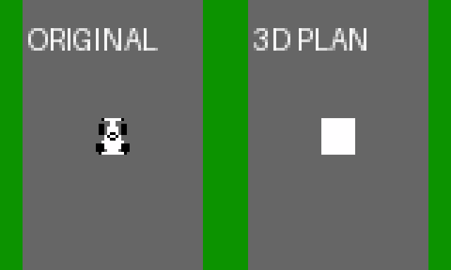

# 元の車体比率と物理状態を使う地面比較

2026年10月16日。**車と道路を同じ1/5縮尺へ合わせ、元のMMC5Racingの位置・車体角を受け取る6502の接続処理を追加した。** 自動周回もこの処理を使う。元の4輪物理を動かすゲームへ進むための比較ROM。

起動は[run_ground_compare.cmd](../../../run_ground_compare.cmd)、標準50MHz。[25MHz起動](../../../run_ground_compare_25mhz.cmd)、[ROM v003](../../../releases/GSU_GroundCompare_v003.nes)、[4視点](results/comparison.png)、[動作GIF](results/interactive_50mhz.gif)。A/Zで地面2方式、SELECT/右Shiftで4視点、B/Xで停止、停止中の左右で地点を送る。

## 車と道路の比率

元の現行GRIP車の画像は16×16px枠、影を除く外形は12×13px。枠の透明余白や1pxの影を車体サイズに含めず、この外形へ合わせた。以前の仮の3D車は16×30px相当で、特に全長が過大だった。

| 寸法 | 元の座標 | 描画ワールドの公称値 |
|---|---:|---:|
| アスファルト幅 | 64px | 12.8 |
| 路肩込み幅 | 80px | 16 |
| 車幅 | 12px | 2.4 |
| 車長 | 13px | 2.6 |
| 車体中心から前／後 | 6／7px | 1.2／1.4 |

車幅／アスファルト幅は18.75%、車長／アスファルト幅は20.3125%。Q9.7頂点への丸め後は車幅12.03125px、車長13.0078125px相当。高さは2Dで定義されないため、上面を地上4px相当、下面を0.5px相当に仮置きした。カメラとコースの寸法はv002から引き継ぐ。

元の車の絵・回転中心・物理ABIと出典hashは[car_source.json](car_source.json)。モデルは比較用の箱形で、GRIPの平面外形が基準。DRIFTのクーペは幅が異なるため、モード別モデルを用意する際に差し替える。元の4輪接地点や摩擦・力・慣性を、この外形に合わせて再計算する処理は入れない。

## 元の挙動を渡す入口

[state_bridge.inc](state_bridge.inc)が実6502の接続処理、[mmc5_state.py](../../../tools/mmc5_state.py)が独立参照。元の物理座標を描画用に書き換えず、完了した物理状態のスナップショットを渡す。

| CPU RAM | 内容 |
|---|---|
| `$0300..0302` | 元の`p_x`、signed16.8の原座標px |
| `$0303..0305` | 元の`p_y`、同形式。北が小さいY |
| `$0306..0307` | 元の`p_heading`、1周65536、0が北、時計回り |
| `$0308..0309` | カメラ角、同形式。車体角とは独立 |
| `$030A..030B` | 物理tick、16bit。描画側は加算しない |
| `$0310` | 0は比較用経路、1は上記外部状態を使用 |
| `$0311` | 変換エラー。出力座標の範囲外は1 |
| `$0312..0313` | 現在公開している画像の物理tick |
| `$0320..032B` | 変換開始時に固定した描画用スナップショット |
| `$0340..035C` | 接続処理だけの一時領域 |

`capture_mmc5_state`は元のZP `$41..46`から位置、`$48..49`から車体角をコピーし、初期カメラ角にも車体角を入れる。tickは呼び出し側が設定する。カメラを速度方向や前回角から追従させる場合は、コピー後に`$0308..0309`だけを設定する。

`render_from_mmc5_state`はGSU停止中に呼ぶ。`view`に0..3を設定し、共有RAMをwork page 4へ向けておく。呼び出し側は終了まで`$0300..030B`を保持する。返り値はcarry clearで成功、setで範囲外。出力は従来のGSU姿勢11word、CPU窓`$6008..601D`（GSU `$8008..801D`）。元の物理ZP `$40..FF`は変更しない。A/X/Yとフラグ、および描画側の`src`/`dst`は破壊する。

位置変換は原点320px、1単位5pxで、`render_Q7 = trunc((original_Q8 - 320*256)/10)`。座標の小数8bitを含めて24bitで処理する。元の640×640コースと周囲の余白に対応する。角度は1024方位のsigned Q8へ変換し、元の64地点・64角度の描画テーブルには制限しない。`p_headsub`は元の積分器に残し、描画は`p_heading`を使用する。

今回の処理時間は実6502で3,975〜4,986cycles、NTSC CPU換算で最大約2.79ms。位置・カメラ変換の費用であり、4輪物理の実行時間は含まない。

## 物理を移植するとき

元の位置・速度・車体角・ヨー・荷重・タイヤ力・GRIP/DRIFT状態と1tickの積分をそのまま維持する。速度は元のpixel/tickのまま扱い、1/5を掛けるのは描画境界だけ。描画の終了回数で物理を進めず、物理と入力は60Hz側で更新し、GSUが空いた時に最新の完了状態を描画要求へコピーする。

描画要求と表示tickを対応させる入口は今回実装したが、現ROMは描画が完了するたびに比較用の経路を1地点送る。物理60Hzのスケジューラー、入力で運転する4輪物理、CPU車、周回、衝突は次の走行版へ接続する。既存ゲーム全体をそのまま読み込むには、MMC5とGSUのレジスター衝突を解決する同居ABIも必要。[3D版の設計](../../../../../memory/projects/mmc5racing/3d/v001/README.md)。

## 確認

実6502の5,219条件で位置・角度・カメラが参照と一致し、原位置の丸め誤差は最大0.03515625px。元の物理ZPと入力スナップショットは不変。外部状態モードでは、1/256px差、経路外位置、後退向き、カメラと異なる車体角の8状態を地面2方式で描き、16画像の786,432画素が一致した。

通常の25／50MHz × 4視点 × 2方式 × 64地点の1,024画像、実ROM128画像のPPU RGBと比較操作も通過。v001／v002の再生成ROMは既存配布hashと一致。[寸法・接続検証](results/state_validation.json)、[描画・性能](results/benchmark.json)、[検証アーカイブ](results/verification.zip)。描画速度は30fps未達の比較版として扱う。

再生成は`build_ground.py --version v003`、`verify_mmc5_course.py --directory projects/nes_superfx/build/ground/v003`、`verify_mmc5_state.py --frontend`、`verify_ground.py --directory projects/nes_superfx/build/ground/v003 --mhz 25`と`--mhz 50`、最後に同じdirectoryを渡して`package_ground.py`。cc65は`D:\HomeBrew\CC65\bin`をPATHへ加える。旧版は`launch_ground.py --version v002`または`v001`で起動できる。
