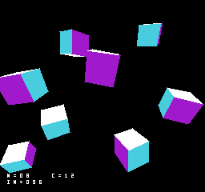
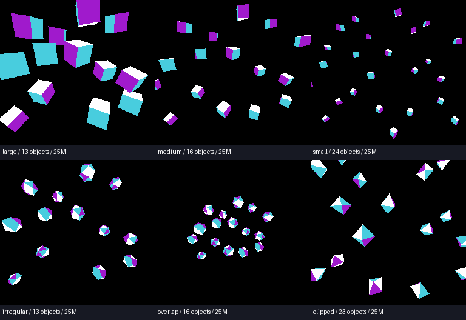

# ポリゴン描画の最適化とゲーム用の予算 v001

2026年10月14日。従来の立方体テストに加え、GSUが３軸変換・透視投影・裏面除去・物体と面の深度順ソート・XY画面端処理・三角形の面塗りまで実行する描画プログラムを作成した。各物体は異なる角度で回り、奥行きも変化する。位置と角度を共有して描画結果をコピーする方式は使わない。

**以下は提案ABI2・Mesen由来GSU時間モデル上の値。RTLサイクル一致、FPGAのFit、RAM帯域、実機性能は未確認。ゲーム本体のAI・物理・音楽・複数meshの転送管理を含む完成ゲームのfpsではない。**

## 起動

[run_polygon_benchmark.cmd](../../../run_polygon_benchmark.cmd)で起動。A（専用設定ではZキー）で、大きい面・中程度の面・小さい面・二十面体・重なり・画面端の各条件と、12.5/25MHz相当の設定を順に変更する。長押しは１回だけ進む。数値はN=物体数、C=12または25（12は12.5MHz相当）、IN=投入三角形数。INには裏面除去される面も含むため、下表の描画三角形数とは異なる。



## 同じクロックでの改善と設定変更を分ける

単位は１画像あたりの三角形。括弧内は物体数。全64姿勢が毎２NTSC field、約30.05fpsを維持した条件。各姿勢で見える面が変わるため範囲で示す。XY画面外へ出て１画素も書かない面は描画数から除外する。

| 条件 | 比較版 CLSR=0/MS0=0 | 最適化版 CLSR=0/MS0=0 | 最適化版 CLSR=1/MS0=1 |
|---|---:|---:|---:|
| 大きい面／立方体 | 22〜30 (5個) | 36〜48 (8個) | 58〜78 (13個) |
| 中程度の面／立方体 | 40〜48 (8個) | 50〜60 (10個) | 83〜96 (16個) |
| 小さい面／立方体 | 66〜78 (13個) | 66〜78 (13個) | 127〜144 (24個) |
| 二十面体 | 61〜69 (7個) | 61〜69 (7個) | 115〜126 (13個) |
| 重なり／二十面体 | 70〜79 (8個) | 70〜79 (8個) | 141〜156 (16個) |
| 画面端／八面体 | 27〜35 (11個) | 37〜46 (14個) | 56〜67 (23個) |

同じCLSR=0では大きい面・中程度の面の上限が増え、小さい面や二十面体の条件では改善幅が小さい。全条件で大幅に増えたとは扱わない。右列は実行イネーブル25MHz相当と乗算待ち短縮の設定を含む結果であり、純粋なソフトウェア改善倍率とは分ける。基準clockはすべて25MHzで、CLSR=0は実行イネーブル12.5MHz相当。既存RTL vendorのMS0記述も参照したが、このモデルの値を回路の実測値とは扱わない。

従来の直交投影・３四角形の立方体テストは、同じ条件で71→75個まで増えた。四角形を２三角形へ換算した数字を、そのままゲーム向けの上限とはしない。詳細は [legacy_fast.json](results/legacy_fast.json)。

## ゲームのために20ms以内へ収めた条件

１画像のGSU描画を20ms以内に収める最大個数も探索した。この表を、描画以外の処理や今後の機能追加を考える際の余裕を持った出発点とする。残り約13msをNES CPUのAI等に丸ごと使えると保証する表ではない。CPUとGSUの処理は並行し、共有RAMの所有権やゲーム固有の処理にも左右される。

| 条件 | 設定 | 物体数 | 描画三角形/画像 | 最長GSU ms |
|---|---|---:|---:|---:|
| 大きい面／立方体 | 12M | 4 | 16〜24 | 18.709 |
| 大きい面／立方体 | 25M | 7 | 32〜42 | 19.400 |
| 中程度の面／立方体 | 12M | 5 | 23〜30 | 18.867 |
| 中程度の面／立方体 | 25M | 8 | 39〜48 | 18.080 |
| 小さい面／立方体 | 12M | 7 | 34〜42 | 18.541 |
| 小さい面／立方体 | 25M | 13 | 66〜78 | 19.005 |
| 二十面体 | 12M | 3 | 25〜30 | 16.800 |
| 二十面体 | 25M | 7 | 61〜69 | 19.646 |
| 重なり／二十面体 | 12M | 4 | 33〜40 | 17.728 |
| 重なり／二十面体 | 25M | 9 | 79〜88 | 19.927 |
| 画面端／八面体 | 12M | 7 | 18〜26 | 18.741 |
| 画面端／八面体 | 25M | 12 | 30〜38 | 19.683 |

フル予算の上限と20msの目安には差がある。また同じ面数でも、画面に占める面積・span数・重なって塗る量・頂点数で費用が変わる。三角形数だけを仕様として固定するより、この条件表を企画の幾何と比較して使う。

## 画面クリア単独の時間

16 KiBの描画バッファ全体を0で埋める時間は、GSU開始から最後のRAM書き込み完了まで、12.5MHz相当で**3.99448ms**、25MHz相当で**3.29412ms**。直後のカウンター初期化の最初の書き込みまで含めても、それぞれ3.99504ms／3.29440msとなる。GSU命令とRAM待ち時間の既存モデルを使った値であり、FPGA実測ではない。RAM待ちが支配的なため、GSU実行クロックを倍にしてもクリア時間は半分にならない。

計測器は変更していない本番payloadを実行し、先頭から16,384バイトが順番に0で書かれることを検査する。両バンクを事前に0xA5で埋め、初回と次回の実行で同じ時間を得た。証拠は[clear_timing.json](results/clear_timing.json)、計測器は[src/clear_probe.cpp](../../../src/clear_probe.cpp)。再現は`cmake --build build --config Release --target nesfx_clear_probe`の後に`build/Release/nesfx_clear_probe.exe build/polygon/fast_cube_spread_h6_n24_c1m1/payload.bin`。

専用のクリア回路で25MHz・毎クロック1バイトを書けると仮定すると、16 KiBには**0.65536ms**、毎クロック2バイトなら**0.32768ms**。これはRAMの幅・待ち時間・ポート競合を含まない理想見積もりで、合成結果ではない。8bit版の仮定では約2.64msを取り戻せる。30fpsの約33.3ms予算の約8%に相当し、クリアを完全に無料化した場合でも追加の処理予算は約3.29msに留まる。

回路案は、描画側バンク・埋める値・開始要求・完了状態を持つ連続書き込み器。表示中のfrontバンクを保護し、GSUの描画開始は完了後とする。GSUの頂点処理とクリアを並列化する場合は、作業RAMと描画RAMのポート／バスを分けるか、競合するアクセスを調停する必要がある。フレーム全体やポリゴン数の増加率は、このクリア単独の短縮率とは区別する。

## 追加回路の優先順位と水平スパン案

ユーザー指定の優先順位は、**RAM範囲フィルの最大速度を最優先**とし、画面座標の矩形フィルは低優先とする。RAM範囲フィルの連続書き込み経路に、画面座標変換や端のマスク処理の待ちを入れない。任意の2bpp色を埋める用途には2バイト繰り返しパターンを候補とする。実効帯域は実RAMの幅・待ち時間・調停条件で決まり、GSU通常書き込みの待ち時間をそのまま専用回路へ流用する前提にはしない。

フラットポリゴンの追加候補は**水平スパンフィル**。GSUが頂点変換・面除去・ソート・左右の辺の更新を行い、各行の`y, x_left, x_right, color, bank`を回路へ渡して区間を塗る。GSUが画素数ぶんPLOTを実行するループを置き換える。頂点処理と辺の計算は残るため、全フレームの高速化率は別途計測が必要。

現行GSUのPLOTも既に8画素単位のピクセルキャッシュを持つ。2bppでは完全に覆う8画素を2バイトへまとめ、部分的に覆う場合だけ既存RAMとの合成を行う。したがって「1画素ごとのRAMアクセスを8画素にまとめるだけで8倍」という見積もりはしない。水平スパン回路の利点は、画素ごとの命令・ループ・キャッシュ構築を減らし、フル8画素区間を直接書ける点にある。左右の部分区間だけはマスク付きの読み出し・修正・書き戻しを行う。

特に短いスパンではコマンド発行費用が問題になる。現行の小型立方体24個では1画像927〜1121スパンに対し3401〜3843画素書き込みであり、数画素のスパンが多い。色・バンクの保持やyの自動更新などで設定回数を減らし、GSUからNES CPUの中継なしで発行できる経路を設計する。必要なら短いスパンはPLOT、長いスパンは回路と使い分けるが、同じ画素領域に対するGSUピクセルキャッシュと外部書き込みの整合、およびpainter順序を保証する必要がある。

水平スパンフィルは検討案で、専用回路・エミュレータとも未実装。まずRAM範囲フィルを独立に評価し、その後にコマンド発行・端の合成・RAM競合を含めた水平スパンの時間を比較する。矩形専用の座標処理を先に増やす必要はない。

## 30fps上限の負荷内訳

INは投入数、描画は画素を書く面数。pixel writesは重なりによる再描画も含み、同じ画素への複数書込みを数える。表のmsには全画面消去、頂点変換、透視、両方の深度ソート、裏面除去、描画が含まれる。

| 条件 | 設定 | 物体 | IN | 描画三角形 | 最大pixel writes | 最長GSU ms |
|---|---|---:|---:|---:|---:|---:|
| 大きい面／立方体 | 12M | 8 | 96 | 36〜48 | 12,234 | 31.847 |
| 大きい面／立方体 | 25M | 13 | 156 | 58〜78 | 20,017 | 33.011 |
| 中程度の面／立方体 | 12M | 10 | 120 | 50〜60 | 4,614 | 32.814 |
| 中程度の面／立方体 | 25M | 16 | 192 | 83〜96 | 7,173 | 33.059 |
| 小さい面／立方体 | 12M | 13 | 156 | 66〜78 | 2,094 | 30.815 |
| 小さい面／立方体 | 25M | 24 | 288 | 127〜144 | 3,843 | 32.367 |
| 二十面体 | 12M | 7 | 140 | 61〜69 | 3,707 | 32.088 |
| 二十面体 | 25M | 13 | 260 | 115〜126 | 6,675 | 32.748 |
| 重なり／二十面体 | 12M | 8 | 160 | 70〜79 | 2,351 | 29.841 |
| 重なり／二十面体 | 25M | 16 | 320 | 141〜156 | 4,652 | 32.353 |
| 画面端／八面体 | 12M | 14 | 112 | 37〜46 | 4,971 | 32.684 |
| 画面端／八面体 | 25M | 23 | 184 | 56〜67 | 6,496 | 32.712 |



## 一般のポリゴン処理として変更した点

- 索引付き頂点を物体内で共有する。変換は物体ごとに毎回行い、９係数の３軸行列と透視投影をGSUが実行する。
- 大きい三角形は16.16の両辺をYごとに進め、直接spanを塗る。辺を全画素たどって全行配列へ書き、その配列を再走査する費用を削る。
- 小さい投影三角形は16行の局所配列を使う辺走査へ切り替える。モデル名や立方体の形を条件にせず、座標差と高さで選択する。
- 裏面除去時の座標差で描画方式を選び、ソートレコードに関数ポインターを持たせる。同じ判定を別shaderで再実行しない。
- 左右の辺は最初に決める。画面内は行ごとのクリップを省き、画面端だけ汎用経路を通す。
- 短いspanと長いspanでPLOTループを分ける。画面消去と積和を展開する。無条件の展開で遅くなった変更は外した。

毎画像16 KiBの描画側RAMを全部消去する。背景静止を利用した消去省略、画像の使い回し、同じ立方体の描画結果のコピー、事前生成したspanは使わない。従来の面塗り版で実験した展開の組合せは [legacy_variants.json](results/legacy_variants.json)。

## 検証

GSU単体で全64姿勢の候補を探し、実NES ROMで成功個数と次の１個を検査した。成功は最終PPU全RGB一致・GSU全画素一致・毎２field提示・期限遅延0・fault=0。次の１個では描画は一致したまま提示期限を逃すことを確認した。20msの候補にもGSU単体の全画素・頂点・カウンター検査を行った。

参照描画はPythonの数式による実装で、GSU命令を実行しない。主計測18条件の成功/次個数失敗36例、A切替12条件、20ms12条件を保存した。Aを８field保持する入力で全構成を一周し、長押しの重複なし・元へ戻ること・各64姿勢の全PPU画素を検査する。

- [benchmark.json](results/benchmark.json)：各条件の三角形・頂点・span・pixel writes・overdraw・clock・提示field・遅延数。
- [interactive.json](results/interactive.json)：A操作と画素の検査。
- [verification.zip](results/verification.zip)：実ROM、GSUプログラム、設定、Lua、RAM画像、PPU画像、trace。
- [sha256.json](results/sha256.json)：ROM・コア・ソース・証跡のhash。
- [design_log.md](design_log.md)：依頼原文と実験経緯。

## 制約と再現

フラット塗り・2bpp・256×240、Z-bufferなしのpainter方式。物体は中心深度、物体内の面は平均深度で並べる。交差する形状の厳密な隠面処理、テクスチャー、半透明、照明は対象外。near/far planeを跨ぐ面は幾何クリップせず拒否する。XYの範囲外はspanで処理し、Y幅512以上の面も拒否する。近面を跨ぐ追加例は安全性と拒否動作の検査であり、上限値には含めない。

同一meshの複数インスタンスを測る構成。meshは立方体・八面体・二十面体を使い、各物体の角度と奥行きは独立した位相を持つ。現在の入力窓は１回の呼出しで１mesh。ゲームへ複数meshや地形を接続する際のバッファと転送管理の費用は別途必要。

メモリーは8000..801Fが設定とカウンター、8040..813Fがmodel、8140..81FFが投影頂点、8200..85FFが物体、8600..8A7Fが64姿勢の行列、8A80..8AFFが奥行き移動表、8B00..92FFが24bit逆数表、9300..93FFが作業領域、9400..9FFFがコード。命令がない9B00..9B7Fを面ソートの作業領域、9B80..9BBFを小面spanとして併用する。slopeコードがこの領域へ伸びないようassemble時にassertする。

再現は専用コアとca65/ld65、Python、Pillowを用意し、projects/nes_superfxで実行する。

```powershell
cmake --build build --config Release
python tools/benchmark_bitmap.py --renderer fast --half 24 16 8 4 2 1
python tools/benchmark_polygon.py --verify-real
python tools/verify_polygon_budget.py
python tools/build_polygon_interactive.py
python tools/verify_interactive_bitmap.py --directory build/polygon/interactive
python tools/package_polygon.py
```

個別ROMは tools/build_polygon.py --mesh icosahedron --scene overlap --half 12 --count 8 など。--renderer baseline で比較版、--clock-select 1 --multiplier-fast で25MHz相当の設定になる。既存のABI1診断ROMとPPUマッパーの仕様は変更していない。
