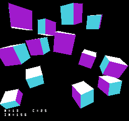
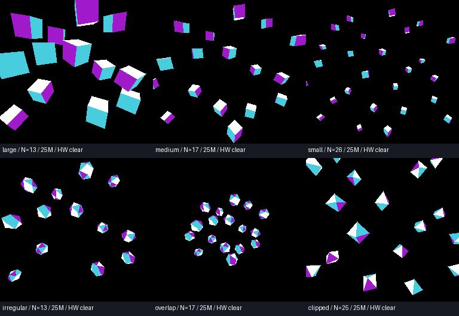

# 専用RAM範囲フィルによるクリアと30fps境界 v002

フレームバッファのクリアをGSU命令から独立した範囲フィル回路へ移した。GSU命令の時間やクロックは変更せず、塗りつぶし完了後にGSUを起動する。毎画像、描画側16 KiB全体を0で埋める。ポリゴンの処理・配置・大きさ・参照描画はv001と同じ。

**専用回路のRTL単体シミュレーションと、Mesenの先行モデルでの結果。N8 ProトップへのABI2配線、RAMの物理ポート、Quartus合成・Fit・外部RAMタイミング・実機動作は未確認。** RTLへ毎クロックRAMの書き込み許可が与えられる条件では、25MHz・8bitで16,384クロック＝**0.65536ms**。Mesenではクリア中にGSUを停止し、CPU RAMアクセスと画面交換をブロックするため、GSUとの帯域競合を隠していない。PPUは別のfrontバンクを読む想定。

## 起動と操作

[run_polygon_benchmark.cmd](../../../run_polygon_benchmark.cmd)で[GSU_PolygonBenchmark_A_v002.nes](../../../releases/GSU_PolygonBenchmark_A_v002.nes)を起動する。**最初は25MHz相当、A（専用設定ではZ）で25→12.5MHzの順に各シーンを切り替える。** N=物体数、C=実行クロック相当（12は12.5MHz）、IN=裏面除去前の投入三角形数。全12条件が専用クリアを使う。汎用三角形の頂点変換・透視投影・ソート・裏面除去・辺の計算・PLOT塗りはGSUで行い、スパン専用回路はまだ追加していない。



## 処理落ち直前の最大個数

各姿勢で見える面が変わるため、描画三角形数を範囲で示す。旧版はGSUによるクリア、新版は専用回路。個数を増やしても既存物体の位置・大きさは変えない。最大個数で全64姿勢を毎２NTSC field（約30.05fps）提示し、次の１個では画素は正しいまま提示期限を逃すことを実NES ROMで確認した。

| 条件 | 設定 | 旧 → 新の最大個数 | 投入三角形/画像 | 描画三角形/画像 | クリア＋GSUの最長ms | 次の１個の遅延回数 |
|---|---|---:|---:|---:|---:|---:|
| 大きい立方体 | 12M | 8 → **9** | 108 | 40〜54 | 32.658 | 29 |
| 大きい立方体 | 25M | 13 → **13** | 156 | 58〜78 | 30.381 | 1 |
| 中程度の立方体 | 12M | 10 → **11** | 132 | 55〜66 | 32.228 | 35 |
| 中程度の立方体 | 25M | 16 → **17** | 204 | 89〜102 | 32.158 | 11 |
| 小型立方体 | 12M | 13 → **15** | 180 | 77〜90 | 32.232 | 20 |
| 小型立方体 | 25M | 24 → **26** | 312 | 137〜156 | 32.088 | 4 |
| 二十面体 | 12M | 7 → **8** | 160 | 68〜79 | 32.729 | 64 |
| 二十面体 | 25M | 13 → **13** | 260 | 115〜126 | 30.118 | 1 |
| 重なる二十面体 | 12M | 8 → **9** | 180 | 79〜88 | 29.977 | 1 |
| 重なる二十面体 | 25M | 16 → **17** | 340 | 151〜166 | 31.566 | 7 |
| 画面端の八面体 | 12M | 14 → **15** | 120 | 37〜46 | 31.413 | 1 |
| 画面端の八面体 | 25M | 23 → **25** | 200 | 60〜73 | 32.511 | 2 |

時間の列はGSU単体計測に範囲フィルとCPUポーリング粒度の待ちを加えた値。NES側のレジスター設定・GO・停止確認・VBlank提示などの費用はこの列に含めず、実ROMの提示間隔とmissed=0で最終判定する。特に１個の追加で重い面が増える場合、余裕が数msあっても次の個数は通らない。投入数と実際に塗る数を混同しない。

上限に合わせたA切替ROMも12条件×全64姿勢で、長押しの重複なし・一周・全GSU画素・最終PPU RGB・提示間隔２field・missed=0を検査した。単独の上限ROMと、その１個上で処理落ちするROMも[一覧](../../../releases/polygon_benchmark_v002.json)に保存した。



## 範囲フィルのCPUレジスター

提案ABI2の拡張。ABI番号は2のまま、`$5FE7` bit0で有無を検出する。対応しないコアではROMが処理を停止する。メモリーは従来どおり40 KiBで、追加の画像バッファはない。

| アドレス | 内容 |
|---|---|
| `$5FE7` bit0 | 範囲フィル機能あり |
| `$5FE8/$5FE9` | 16bit開始アドレス。40 KiB RAM内の物理オフセット |
| `$5FEA/$5FEB` | 16bitバイト数。0は即時完了の何もしない操作 |
| `$5FEC/$5FED` | 繰り返す２バイト。開始位置を基準にlow→high→low… |
| `$5FEE` | 1で開始。範囲・所有権を検査してから実行 |
| `$5FEF` | bit0=実行中、bit1=完了、bit2=エラー。bit1/2は1を書いて解除 |
| `$5FD8..$5FDF` | フィルで書いた基準クロック数、little endian。16 KiB完了時は16384 |
| `$5FE3` bit4 | フィル要求のエラー。既存faultレジスターの拡張 |

描画モード中は表示側frontバンクとの重なりを、開始前に全範囲検査して拒否する。範囲外・アドレス加算の桁あふれ・実行中の再開始も拒否する。実行中の設定変更は拒否し、RAMへのCPUアクセス、GSUのGO、バンク交換をブロックする。ソフトリセットはフィルを中止し、既に書いたRAMを保持する。途中状態はMesenの保存状態へ含める。

## RTLと検証の境界

[ram_range_fill.vhd](../../../rtl/ram_range_fill.vhd)は合成可能な独立RAMマスター。startでアドレス・長さ・パターンを保持し、ram_requestが出ている間、ram_grantを受けた各クロックで１バイトを書く。許可がない間はアドレスと値を保持する。長い連続領域に画面座標変換や矩形の端マスクを挟まない。上位回路でCPU窓のデコード、GSU停止・front交換の保護、RAMポートの調停を接続する必要がある。ABI1の外部リポジトリとトップ回路は変更していない。

[tb_ram_range_fill.vhd](../../../rtl/tb_ram_range_fill.vhd)で16 KiBを正確に16384回の許可で埋めること、範囲外が変わらないこと、２バイトパターン・奇数開始位置・奇数長・長さ0・両frontバンク保護・待ち・実行中の再要求・リセット中止を検査した。GSUを含むN8 Pro全体のRTLシミュレーションではない。C++側にも範囲・実行時間・保護・CPUクロック経由の進行を検査する独立したcontractを追加した。

MesenのGSU命令・RAM待ち・ピクセルキャッシュの費用は固定ソースのまま。新しい回路のRAM書き込み帯域だけを25MHzの１バイト/clockとして別に進める。実機でRAM許可に待ちが入ればクリア時間も伸びる。

## 証跡と再現

- [benchmark.json](results/benchmark.json)：最大個数12条件、次個数の失敗12条件、全64姿勢のnative時間。
- [interactive.json](results/interactive.json)：A操作と各64姿勢の検査。
- [rtl.json](results/rtl.json)：GHDLシミュレーション、回路ソースhash。
- [contracts.log](results/contracts.log)：ABI1・ABI2・範囲フィル・従来cubeの４試験。
- [verification.zip](results/verification.zip)：ROM、payload、Lua、RAM・PPU画像、trace。
- [sha256.json](results/sha256.json)：ROM、専用コア、ソースと証跡のhash。

プロジェクト直下で実行する。

```powershell
python tools/build.py
python tools/setup_runtime.py
cmake --build build --config Release
ctest --test-dir build -C Release --output-on-failure
python tools/verify_fill_rtl.py --ghdl <ghdl.exe>
python tools/benchmark_fill.py
python tools/build_polygon_interactive.py --hardware-clear
python tools/verify_interactive_bitmap.py --directory build/polygon/interactive_v002
python tools/package_fill.py
```

従来の機能範囲（フラット2bpp、テクスチャ・Z-bufferなし、近面交差の幾何クリップなし）は[v001](../v001/README.md)と同じ。ゲーム処理を含む実用面数の保証ではなく、描画単体の限界測定。
