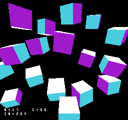
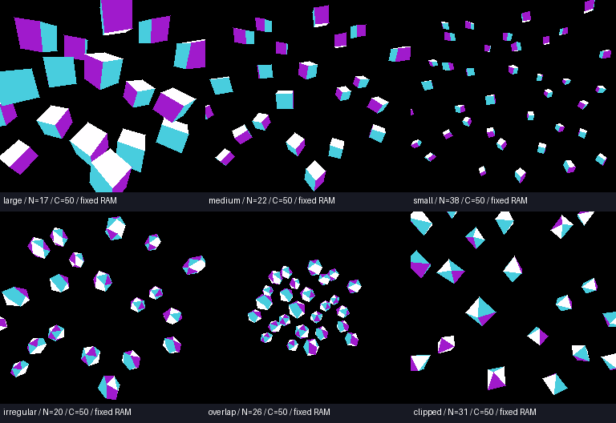

# GSU 50MHz相当・RAM待ち据え置きの30fps境界 v003

2026年10月15日。ユーザーの「50MHz相当だとどうなる？」に対して、25MHz版v002と同じ描画・配置・面積・クリア方法で、GSU実行を50MHzへ変更して比較した。

**エミュレーター上の実行時間モデルでの測定。FPGA・実機の50MHz動作や性能を検証したものではない。** CLSR=1、MS0=1で、GSU基準・実行イネーブルが50MHz相当。NES CPU・PPU・音源の時間は変更しない。GSU命令キャッシュ内の命令実行と乗算のクロックを上げる一方、外部メモリーの待ちと専用クリア回路は従来の実時間を保つ。

具体的には、既存Mesenコアで明示される5基準クロック（25MHzで200ns）のメモリー待ちを、50MHzでは10クロックにする。16バイトの命令キャッシュ補充、RAM/ROMバッファの待ち、PLOT/RPIXのメモリー待ちも同じ倍率にする。CLSR=0の6クロック経路は12クロックとなる。ベースのGSU処理は固定ソースのまま、ホストアダプターのMemoryAccessClocksで待ちを選ぶ。既存コアのメモリーアクセスモデルを実回路の完全なバス波形とみなすものではない。

専用クリアは引き続き25MHz・１バイト/clockで、16 KiBに**0.65536ms**。クリア中はGSUを停止し、クリア完了後にGSUを起動する。RAM待ちの追加を含む50MHz先行モデルであり、別スレッドのvendor GSU RTLをそのまま50MHzへ変更した測定ではない。実機用には待ちの挿入やRAM調停を含めた統合検証が必要。

## 起動

[run_polygon_benchmark_50mhz.cmd](../../../run_polygon_benchmark_50mhz.cmd)で[GSU_PolygonBenchmark_A_v003.nes](../../../releases/GSU_PolygonBenchmark_A_v003.nes)を起動する。画面のC=50が50MHz相当、N=物体数、IN=裏面除去前の投入三角形数。A（専用設定ではZ）で６シーンを切り替える。v002の通常ランチャーは25MHzのまま残している。

50MHzの設定は子プロセスだけの`NES_GSU_CLOCK_HZ=50000000`で有効にし、ABI1には適用しない。`tools/launch.py --mapper n8pro-gsu-abi2 --gsu-mhz 50 --controller-a releases/GSU_PolygonBenchmark_A_v003.nes`も使用できる。ROMは`$5FE6`の基準MHz値を検査し、25MHzで誤って実行された場合は停止する。



## 30fpsの最大個数

25MHz側は専用クリア済みv002の結果。両方とも各物体を独立に変換・透視投影・ソート・面除去・塗りつぶしする。同じ物体の画像コピーや背景の使い回しは行わない。数を増やしても既存物体の位置と大きさは変えない。

| 条件 | 25MHz → 50MHzの最大個数 | 個数比 | 投入三角形/画像 | 描画三角形/画像 | クリア＋GSUの最長ms | 次の１個の遅延回数 |
|---|---:|---:|---:|---:|---:|---:|
| 大きい立方体 | 13 → **17** | 1.31倍 | 204 | 81〜102 | 32.072 | 6 |
| 中程度の立方体 | 17 → **22** | 1.29倍 | 264 | 113〜131 | 32.541 | 17 |
| 小型立方体 | 26 → **38** | 1.46倍 | 456 | 204〜228 | 32.508 | 1 |
| 二十面体 | 13 → **20** | 1.54倍 | 400 | 179〜192 | 32.543 | 6 |
| 重なる二十面体 | 17 → **26** | 1.53倍 | 520 | 236〜253 | 32.192 | 9 |
| 画面端の八面体 | 25 → **31** | 1.24倍 | 248 | 69〜85 | 32.471 | 5 |

全６条件の最大個数で、64姿勢のGSU全画素・最終PPU RGB・毎２NTSC field提示（約30.05fps）・missed=0を確認した。１個増やしたROMは画素が正しいまま提示期限を逃す。A切替版も６条件×64姿勢で画素・提示間隔・長押しの重複なし・一周を検査した。

時間の列は50MHz単位のGSUクロック数と、25MHzフィルの待ちを50MHzへ換算した値を合計して50000で割る。NES CPUの設定・GO・停止確認・提示の費用は列に含めず、実ROMの提示間隔で最終判定する。生のGSUクロック数を25MHzで割らないこと。fill_clocksはフィル専用25MHzクロックの数、fill_wait_clocksはGSU側50MHz基準の数であり、異なる時間軸を持つ。

個数の増加は約1.24〜1.54倍。クロックを２倍にしてもRAM待ちとキャッシュ補充の実時間は残るため、個数は２倍にはならなかった。描画三角形数も面積・spans・頂点数・重なりで変わる。ゲーム処理・テクスチャ・Z-buffer・近面の幾何クリップを含む完全なゲームの面数保証ではない。



## 互換性と証跡

25MHz設定では従来コアの待ちクロック数をそのまま使用する。v002の全12条件×64姿勢について、GSU時間・クリア待ち時間・頂点/面カウンターが完全一致した。ABI1・ABI2・範囲フィル・従来cubeの４contract試験も通過。GSU基準MHzとフィルの分数クロック状態は保存状態に含める。

- [benchmark.json](results/benchmark.json)：50MHz６条件の最大と次個数の失敗、nativeの64姿勢。
- [interactive.json](results/interactive.json)：A操作と６条件の検査。
- [clock25_compat.json](results/clock25_compat.json)：25MHz版12条件×64姿勢の完全一致。
- [contracts.log](results/contracts.log)：４contract試験。
- [verification.zip](results/verification.zip)：ROM、payload、設定、Lua、画像、trace。
- [sha256.json](results/sha256.json)：ROM・コア・ソース・証跡のhash。
- [単独ROM一覧](../../../releases/polygon_benchmark_v003.json)：最大個数と処理落ちする次個数。

## 再現

プロジェクト直下で実行する。

```powershell
python tools/build.py
python tools/setup_runtime.py
cmake --build build --config Release
ctest --test-dir build -C Release --output-on-failure
python tools/verify_clock25_compat.py
python tools/benchmark_fill.py --gsu-mhz 50
python tools/build_polygon_interactive.py --hardware-clear --gsu-mhz 50
python tools/verify_interactive_bitmap.py --directory build/polygon/interactive_v003
python tools/package_clock50.py
```

範囲フィル回路のRTLとレジスターは[v002](../v002/README.md)、描画方式と制約は[v001](../v001/README.md)を参照。
