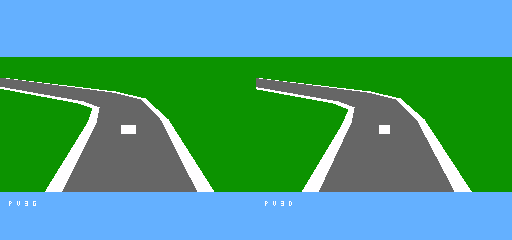

# 元の走行挙動で運転する3D版

2026年10月16日。元のMMC5Racingの加速・操舵・ブレーキ・横滑り・路外減速を使い、GSUの3D表示で運転する走行版。前の自動周回を除き、**元の完成ROMの6502物理コードを60Hzで実行し、その結果を描画する。**

起動は[run_racing_3d.cmd](../../../run_racing_3d.cmd)、標準50MHz。[25MHz起動](../../../run_racing_3d_25mhz.cmd)、[ROM](../../../releases/GSU_MMC5Racing3D_v001.nes)、[検証結果](results/verification.json)、[GRIP動画](results/drive_grip_50mhz.gif)、[DRIFT動画](results/drive_drift_50mhz.gif)。旧[地面比較](../../../run_ground_compare.cmd)は自動周回のまま保存している。

## 操作

| パッド | 未割当時のキー | 操作 |
|---|---|---|
| A | Z | 元のアクセル |
| B | X | 元のモード別ブレーキ／DRIFT操作 |
| 左／右 | 左右矢印 | 元の操舵 |
| SELECT | 右Shift | 車載・近い追従・高い追従・俯瞰 |
| 上 | 上矢印 | ポリゴン／MODE7風地面 |
| 下 | 下矢印 | GRIP／DRIFT変更、開始位置へ戻る |
| START | Enter | 同じモードで開始位置へ戻る |

初期はGRIP、高い追従視点、ポリゴン地面。下段のG/Dがモード、P/Tが地面方式、V1..4が視点。開始とリセットでは、元の初期RAM表を読み込むため数秒待つ。

## 挙動が一致する範囲

元の位置・速度・車体角・ヨー、小数積分器、荷重・ばね、タイヤ力、操舵角、スロットル、DRIFT内部状態、路面判定と路外の減速・回復を維持する。元の単位はpixel/tickのまま。車幅はGRIP12px、DRIFT10px、車長13px相当で、道路と同じ1/5縮尺を表示側にだけ使う。

自車の自由走行を比較する版で、CPU車、周回・ゴール、木や建物の表示と景物衝突、音はまだ接続していない。景物のない画面で見えない木へ衝突しないよう、元の景物衝突・クラッシュシーンへの分岐を外している。この版をレース全体の完全移植とは扱わない。路外判定は元のマスクが正本で、道路表示は既存の19断面近似と64×64画像を使う。

## 一致の確認

原版はSHA256 `be71757a0ef8844cd2306d8d07ffd8b8ff2e8eebe37cd3242b3e077de3ffb0cc` の `MMC5Racing_Results_136x184.nes` に固定。開発元が並行更新されても基準を途中で変更しない。

1. 無変更の原版を通常MMC5で動かし、GRIP／DRIFT各128回の物理更新と開始RAMを採取。
2. 同じ入力列・開始状態を独立6502で再実行し、描画用のC2..C4を除く物理ZP40..E9の**167bytes**が原版の実行記録と一致。
3. 走行ROMを実Mesenで動かし、2モード×2地面×25／50MHz、各1,024回、計**8,192回**を原版コードの実行結果と比較。路外状態と回復時間も一致し、すべて1fieldに1回更新。
4. 走行中のGSU画像とPPU画素を独立描画参照で照合。実パッドでの視点・地面・モード変更、START、描画座標範囲外からのSTART復帰も確認。

2D版の描画後の値を使う旋回補正があり、DRIFTでは旧カメラの`$68F3`を省くと角度がずれる。旧カメラの数値計算も元コードで実行し、この依存を維持する。実際に画面へ出すカメラはGSU側の4視点で、旧カメラの画像を描いているわけではない。

物理＋旧カメラの採取最長はGRIP6,772cycles、DRIFT9,519cycles（NTSC CPUで約3.78／5.32ms）。このほかNMIの退避・入力・公開などの費用がある。描画は数fieldsを要し、30fps未達でも物理の更新頻度は落ちない。[実行条件と提示間隔](results/verification.json)。実機・FPGAの性能値ではない。

## 接続と再現

開発用マッパー名は`n8pro-racing-gsu`。mapper0ヘッダー、PRG1MiB・CHR8KiBを明示選択する。元のPRG108..126はbyte不変。固定バンク127の変更は、景物分岐を元の路外更新呼び出しへ戻す3bytesと、周回/UIの直前で返す1byteだけ。

CPU側の8KiB PRGバンク、128KiB WRAM、MMC5乗算を用意し、GSUレジスターを`$4800..4AFF`、表示・フィル制御を`$4FD0..4FF2`へ移す。`$4FF3`はCPU窓`$6000..7FFF`の選択で、0が元のWRAM、1がGSU RAM。NMIの物理更新は元のWRAMを使い、描画側のZP・バンク・窓を戻して復帰する。GSUの要求は完了スナップショットから作り、VBlankで公開する。このモデルは物理に必要なMMC5側機能の接続で、MMC5のPPU・追加音源を含む正式同居ABIではない。

[source_snapshot.zip](source_snapshot.zip)に基準ROM、両モードの開始RAM、無変更原版の入力・状態列を保存した。`python projects/nes_superfx/tools/build_racing.py`で再ビルドできる。cc65は`D:\HomeBrew\CC65\bin`をPATHへ加える。初回はsnapshotをbuild先へ展開する。実行検証は`verify_racing.py --all`、操作は`verify_racing_controls.py`、最後に`package_racing.py`。専用コアは`build.py`と`setup_runtime.py`で更新する。

原版からの新規採取は`capture_racing_baseline.py --rom <固定した原版ROM>`。現在のmainを自動選択して過去の検証基準を上書きしない。RAM全体と描画の採取データは[検証zip](results/verification.zip)、hashは[配布manifest](../../../releases/racing_3d_v001.json)に記録する。

## 左右の対応

左右反転の指摘を受け、GSUのカメラ横方向・車体の右方向・地面画像の走査方向を修正した。元のXは東、Yは南で、北向きなら東が画面右になる。物理や入力を変えて合わせず、描画座標の基準を直している。[方位と左右の実GSU検証](results/handedness_validation.json)、[4方向の目印](results/handedness.png)。東西南北×4視点×2方式の32画像で右の白・左の灰色が正しく出て、旧版へ同じ目印を渡すと左右逆を検出する。
